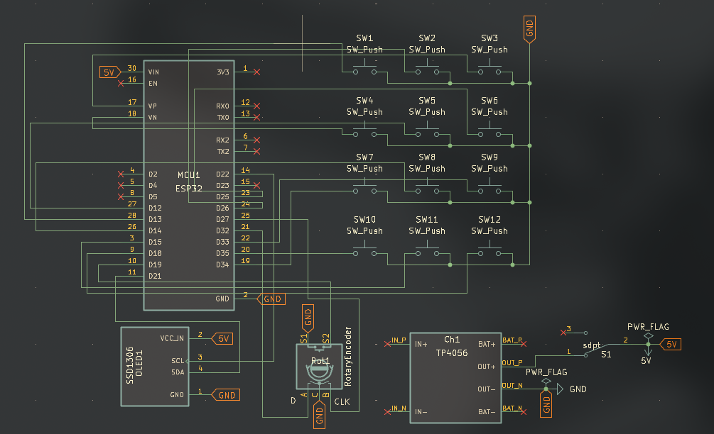
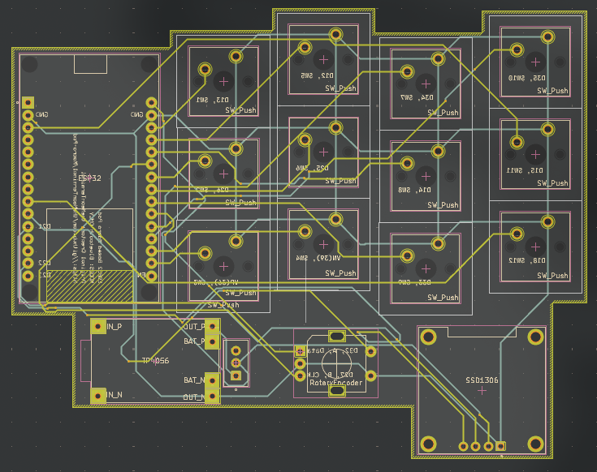
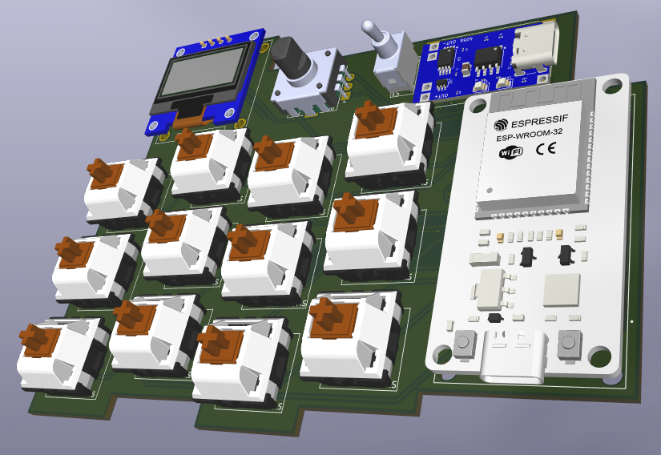

# BLE Macro Pad

### ESP32 wireless macro pad with 12 customizable buttons, a rotary encoder, and an OLED

**12 configurable macro actions · Rotary volume control · OLED feedback · Bluetooth LE**

  

*A small DIY shortcut pad for media controls and everyday keyboard macros.*

---

## About

An ESP32 based BLE Macro Pad I made as a project to experiment with BLE on the ESP32 and simulate keyboard/mouse (mouse not used here) actions wirelessly via BLE.

Each button on the pad has its own function dedicated to make any required action on the pc or the phone its connected to.

> [!IMPORTANT]
> **Arduino IDE ESP32 board package: version `2.0.17`.** Use **ESP32 by Espressif Systems v2.0.17** for this project. The current firmware does **not compile with newer core versions** due to changes made to the Bluetooth API by Espressif.

## Hardware Design

### 01 / Circuit Schematic

### 02 / PCB Layout

### 03 / PCB 3D View

## Currently Implemented Features

- **Bluetooth LE keyboard:** Send keystrokes wirelessly, while also consuming very amount of battery.
- **Customizable macros:** Dedicated `b1()`–`b12()` functions make actions easy to edit and customize to ones needs and wishes
- **Rotary encoder:** To adjust connected system volume.
- **OLED feedback:** Show the last triggered action on a 128x64 I2C OLED Display - can be customized to show animations, gifs (in monochrome) and really anything.
- **Expandable firmware:** Some of the buttons remains unused as of today, so it allows it to have some space for more functionality.

---

## BoM (Bill of Materials)

| PART | QUANTITY | PURPOSE |
| ----- | --- | ---- |
| ESP32 | 1 | Main BLE control unit and processing unit |
| OLED Display | 1 | Dsiplay currently transmited signal or any other stat (customizable) |
| Rotary Encoder | 1 | To adjust volume of the connected device |
| Mechanical Switches | 12 | The actual input for the macros itself |
| Mechanical Switch Keycaps | 12 | To put on the mechanical switches |
| PCB | 1 | To house and connect all electronics |
| TP4056 Charging Module | 1 | To charge the onboard battery |
| Battery (Li-Ion any mAh) | 1 | To Power the system |
| Slide switch | 1 | To turn the system on or off |

---

## Button Layout

The schematic uses 12 independent pushbuttons. Each button connects between its GPIO and GND and is read with `INPUT_PULLUP`.

| Button | GPIO (PCB schematic) | Default firmware action |
| :--- | :--- | :--- |
| SW1 | GPIO 13 | Up arrow |
| SW2 | GPIO 25 | Down arrow |
| SW3 | GPIO 36 (VP) | Left arrow |
| SW4 | GPIO 12 | Right arrow |
| SW5 | GPIO 39 (VN) | Space |
| SW6 | GPIO 26 | Next track |
| SW7 | GPIO 34 | Previous track |
| SW8 | GPIO 14 | Play / pause |
| SW9 | GPIO 33 | Custom |
| SW10 | GPIO 35 | Custom |
| SW11 | GPIO 15 | Custom |
| SW12 | GPIO 18 | Custom |

**Other connections:** The OLED uses I²C; the rotary encoder is intended for volume control. Refer to the schematic for their PCB connections.

## Firmware Working

This code uses the <a href="https://github.com/T-vK/ESP32-BLE-Keyboard">BLEKeyboard</a> libray - detects button presses with a function that I found online, the function returns `true` immediately when a button is pressed and periodically sends `true` (300ms) if the button is not released at all, very helpful function, cant really tell how it works, but it works great and is fully non-blocking. The main code starts only the BLEKeyboard is connected to a device (name, manufaturer and charge can be configured the object instance outside and above the setup function), the code simply checks for button presses (form the switch case part) and calls the button function associated with the button and same with rotary encoder - checks the reading, manages an internal counter and send BLE signal
